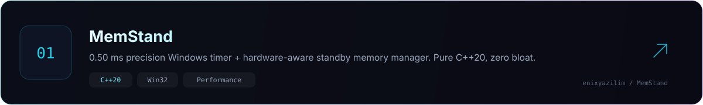
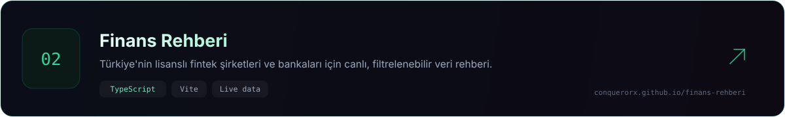
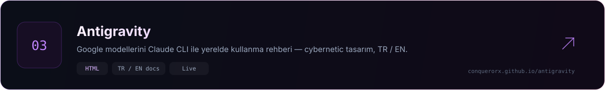

  

 

 

## `01` &nbsp;Hakkımda

> *Donanıma yakın çalış, arayüzü temiz tut.*

| 🇹🇷 &nbsp;Türkçe | 🇬🇧 &nbsp;English |
| :--- | :--- |
| Windows internals, yüksek çözünürlüklü zamanlayıcılar ve bellek yönetimi üzerine **C++20** ile çalışıyorum. Ürün tarafında **Flutter** ve **TypeScript** ile insanların gerçekten kullandığı arayüzler kuruyorum. | I work in **C++20** on Windows internals, high-resolution timers and memory management — then ship the product side in **Flutter** and **TypeScript**. |

 

**`Ne ile çalışıyorum`**

  
  
  
  
   
  
  
  
  
   
  
  
  
  

 

## `02` &nbsp;Öne çıkanlar

 

 

 

## `03` &nbsp;Diğer işler

| Proje | Ne yapar | Stack |
| :--- | :--- | :--- |
| **[deprem-istasyon](https://github.com/ConquerorX/deprem-istasyon)** | Sade, hızlı bir deprem bilgi istasyonu. | `HTML` `JS` |
| **[SideStore](https://github.com/ConquerorX/SideStore)** | Yan yükleme (sideloading) için tek sayfalık kurulum rehberi. | `HTML` |
| **[antigravity](https://github.com/ConquerorX/antigravity)** | Google modellerini Claude CLI üzerinden yerelde çalıştırma rehberi — TR / EN. | `HTML` `Docs` |

 

## `04` &nbsp;Rakamlarla

 

 

## `05` &nbsp;Katkı akışı

  <picture>
    <source media="(prefers-color-scheme: dark)" srcset="https://raw.githubusercontent.com/ConquerorX/ConquerorX/output/snake-dark.svg" />
    <source media="(prefers-color-scheme: light)" srcset="https://raw.githubusercontent.com/ConquerorX/ConquerorX/output/snake-light.svg" />
    
  </picture>

 

  <code>sistem seviyesinden arayüze — aynı özenle.</code>

